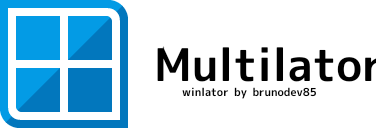

	

# Multilator

Winlator is an Android application that lets you to run Windows (x86_64) applications with Wine and Box86/Box64,
but with more features

For more information and releases, please visit the main repository: https://github.com/brunodev85/winlator-app

# Credits and Third-party apps

- [winlator-app](https://github.com/brunodev85/winlator-app)

- [GLIBC Patches by Termux Pacman](https://github.com/termux-pacman/glibc-packages)

- [wine](winehq.org)

- [Mesa (Turnip/Zink/VirGL)](mesa3d.org)

- [DXVK](github.com/doitsujin/dxvk)

- [VKD3D](gitlab.winehq.org/wine/vkd3d)

- [CNC DDraw](github.com/FunkyFr3sh/cnc-ddraw)

Special thanks to all the developers involved in these projects. 
Thank you to all the people who believe in this project.
